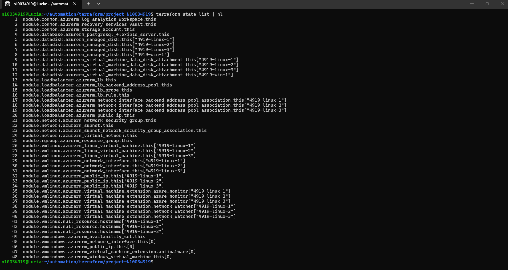
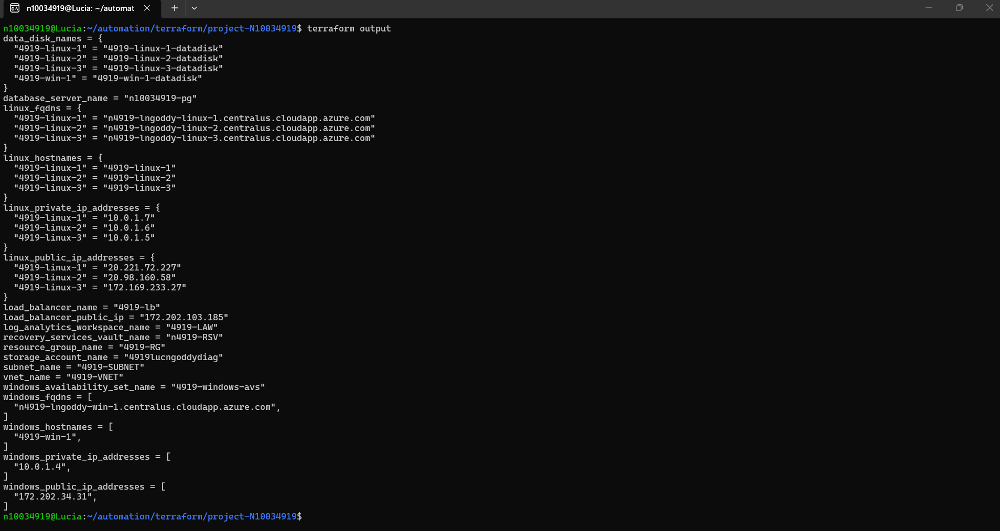
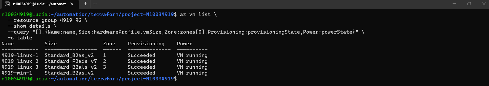
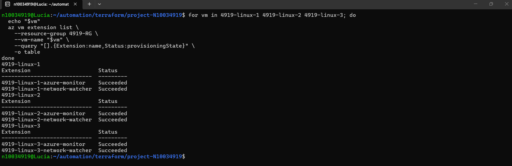
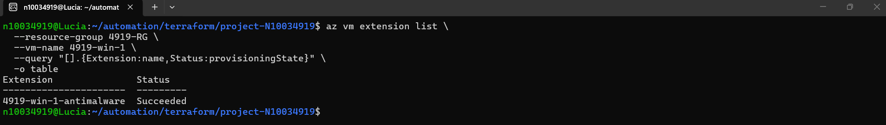
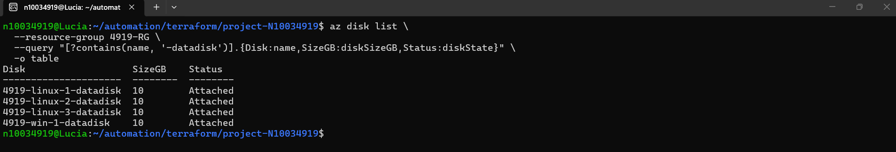
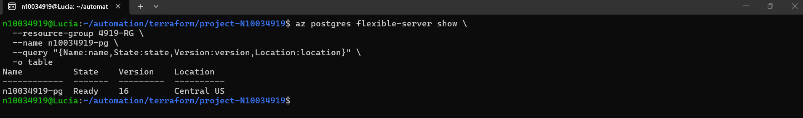
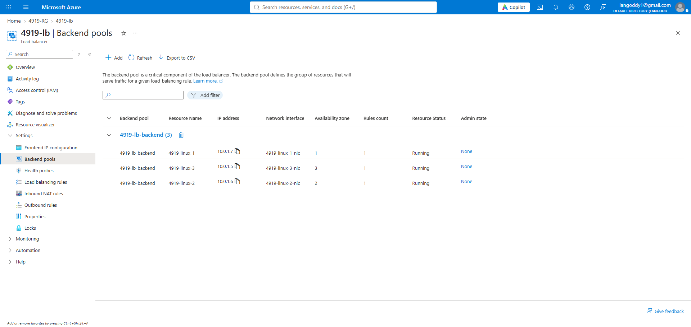
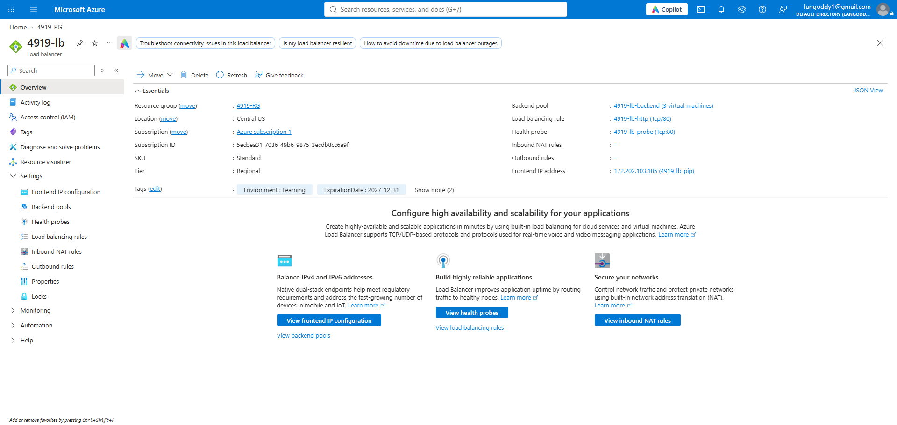
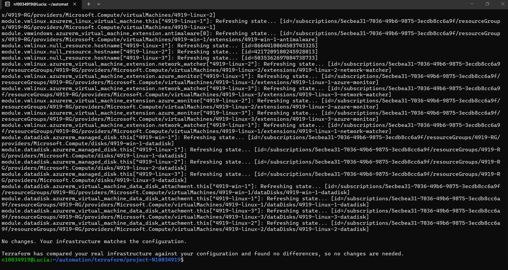

# Terraform Deployment Test Evidence

**Student:** Lucia Ngoddy  
**Humber ID:** N10034919  
**Course:** CCGC 5502 — Automation  
**Instructor:** Professor Asghar Ghori  
**Region:** Central US

## Scope

These screenshots document the deployed infrastructure after troubleshooting.
They supplement the required fresh-deployment video; they do not replace it.

## Verification Results

| Test | Expected result | Observed result |
|---|---|---|
| Resource count | Exactly 48 Terraform state entries | Passed: 48 entries |
| Root outputs | Resource names, VM hostnames, FQDNs, and IP addresses displayed | Passed |
| VM status and zones | Four running VMs; Linux VMs in zones 1, 2, and 3 | Passed |
| Linux extensions | Azure Monitor and Network Watcher on each Linux VM | Passed: all six Succeeded |
| Windows extension | Antimalware installed | Passed: Succeeded |
| Data disks | Four attached 10 GB disks | Passed |
| PostgreSQL | Flexible Server ready | Passed: PostgreSQL 16, Ready |
| Backend pool | All three Linux VMs associated | Passed |
| Load balancer configuration | Public frontend, backend pool, rule, and probe | Verified: Standard SKU, TCP/80 rule and probe |
| Terraform consistency | No configuration differences | Passed: No changes |

## 1. Terraform Resource Count

Command: `terraform state list | nl`

The state contains exactly 48 managed resource instances, including
the three null resources used for hostname provisioners.

## 2. Root Module Outputs

Command: `terraform output`

The root module displays the child-module outputs, including resource
names and Linux and Windows hostnames, FQDNs, and IP addresses.

## 3. VM Status and Availability Zones

All four VMs show successful provisioning and are running.

| VM | Size | Zone |
|---|---|---|
| 4919-linux-1 | Standard_B2as_v2 | 1 |
| 4919-linux-2 | Standard_F2ads_v7 | 2 |
| 4919-linux-3 | Standard_B2als_v2 | 3 |
| 4919-win-1 | Standard_B2as_v2 | Availability set; no zone assigned |

The Linux VMs follow the separate-zone requirement in the project
details. The rubric instead mentions a Linux availability set;
this documentation records which interpretation was implemented.

## 4. Linux Extensions

Azure Monitor Agent and Network Watcher provisioning succeeded
on all three Linux VMs.

CentOS 8.2 was initially deployed as specified. Azure Monitor Agent
installation failed with "Unsupported operating system: centos 8".
The Linux images were changed to Ubuntu 24.04, after which all six
extensions provisioned successfully.

Ubuntu is a documented deviation from the specified CentOS image.
Extension installation success does not by itself prove that
monitoring data is being collected in Log Analytics.

## 5. Windows Antimalware

The Windows Server 2022 Antimalware extension shows Succeeded.

## 6. Data Disks

All four managed data disks are 10 GB and show Attached.
A separate CLI check confirmed LUN 0 for each VM.

These checks verify Azure disk attachment, not filesystem formatting
or mounting inside the operating systems.

## 7. PostgreSQL Flexible Server

The PostgreSQL Flexible Server is Ready, running version 16 in Central US.

Public network access is disabled. This test verifies provisioning
status, not a database client connection.

Azure assigned zone 1 during creation. The configuration was updated
to preserve that zone and eliminate the subsequent planned difference.

## 8. Load Balancer Backend Membership

The backend pool contains the network interfaces of all three Linux
VMs across zones 1, 2, and 3.

The portal's Running status refers to the VMs, not HTTP probe health.

## 9. Public Load Balancer Configuration

The deployed load balancer uses Standard SKU with a public frontend,
a TCP/80 rule, and a TCP/80 health probe.

The assignment specifies Basic SKU. Standard was used because
Microsoft retired Basic Load Balancer on September 30, 2025.

Reference:
https://learn.microsoft.com/en-us/azure/load-balancer/load-balancer-basic-upgrade-guidance

An HTTP request to the frontend timed out. An SSH check on Linux VM 1
confirmed that nothing was listening on port 80. Successful HTTP
traffic distribution has therefore not been demonstrated.

The supplied load balancer requirement asks for provisioning,
backend membership, and a name output; it does not explicitly
require installation of a web application.

## 10. Terraform Consistency Check

Command: `terraform plan -no-color`

Terraform reported:
"No changes. Your infrastructure matches the configuration."

This confirms configuration consistency at the time of the test,
not application-level functionality or guaranteed future capacity.

## Additional Troubleshooting and Feedback

### Subscription registrations

Initial deployment failed because these Azure providers were not registered:

- Microsoft.OperationalInsights
- Microsoft.RecoveryServices
- Microsoft.DBforPostgreSQL

They were registered through Azure CLI. Log Analytics, the Recovery
Services vault, and PostgreSQL subsequently deployed successfully.

### Quota and allocation failures

The Central US Basv2 quota was increased to 8 vCPUs. Despite sufficient
quota and unrestricted SKU listings, some zonal allocations failed.

Per-VM size overrides were introduced. Linux VM 1 succeeded with
Standard_B2as_v2. Linux VM 2 ultimately succeeded with
Standard_F2ads_v7 and Ubuntu 24.04. Linux VM 3 retained
Standard_B2als_v2. All selected VM sizes have two vCPUs.

Failed VM objects were imported into Terraform state for recovery.
When resizing failed during the power-off operation, the affected
VMs were replaced through Terraform.

### Resource naming

Azure rejected the original vault name and public DNS labels because
they began with numbers. A leading "n" was added while retaining
the student identifier.

### Windows password

Windows VM validation rejected a password that met only two character
categories. The password was updated to meet complexity requirements.
Passwords are stored in an ignored local variable file and are not
included in this repository.

### Lessons learned

- Quota, subscription eligibility, and actual zonal capacity are separate checks.
- An available OS image may not support a required extension.
- Failed deployments can leave Azure resources that need state reconciliation.
- A successful infrastructure deployment does not prove application availability.
- A no-change plan should follow recovery and configuration updates.

## Use of AI Assistance

I used AI assistance to clarify Terraform concepts, revise
configuration blocks, and interpret deployment errors. I executed the commands, reviewed the plans and results,
and verified the deployed resources through Azure CLI and the Azure portal.
The screenshots document the results from my own Azure environment.
